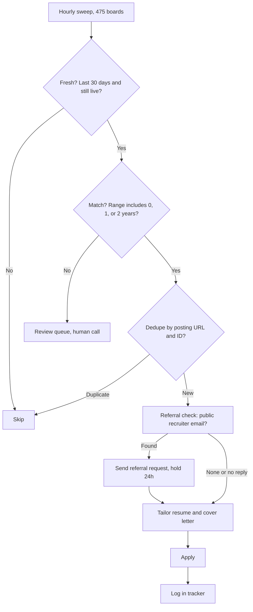

# Automated Job Application Agent

An hourly automated system that finds junior data analyst roles, filters them, tailors a resume and cover letter per role, and submits the application, with dedupe and a review queue for anything senior or borderline.

Live product: https://www.jobsweep.tech
Playbook price: Rs 99 in India, via Razorpay.

> This repo is the sanitized demo version. The full step-by-step playbook, prompts, and tracker are the paid product at jobsweep.tech. This repo shows the architecture and the core logic, not the full playbook.

## Result in 10 seconds

- Submitted 130 tailored applications in 6 weeks, as measured by 130 applications logged with a tailored resume and cover letter each, by building an hourly sweep of about 475 company boards that filters for 0-2 year roles and dedupes by posting URL and ID.
- Cut manual searching to an hourly automated run, as measured by daily sweeps with a 30-day freshness filter and a review queue for senior or borderline roles, by building match filtering, resume tailoring, and tracker logging into one system.
- Turned the system into a paid playbook, as measured by a live product at jobsweep.tech priced at Rs 99 with Razorpay checkout, by documenting the sweep, match filter, resume tailoring, and tracker step by step.

## How it works in 30 seconds

1. Sweep about 475 company boards every hour, across Lever and Greenhouse, plus other career pages.
2. Keep only roles published in the last 30 days and still live.
3. Keep only roles whose experience range includes 0, 1, or 2 years. A range starting at 3+ goes to review, never auto-apply.
4. Dedupe by posting URL and posting ID, never by company name alone.
5. Check for a public recruiter email. If one is found, send one referral request and hold 24 hours.
6. Tailor a 1-page resume and cover letter from a master resume, then apply and log it.

## Workflow



Text version of the same flow, for a quick scan:

```
Hourly sweep (475 boards)
  -> Fresh? Last 30 days and still live?
       No: Skip
       Yes: Match? Range includes 0, 1, or 2 years?
            No: Review queue, human call
            Yes: Dedupe by posting URL and ID?
                 Duplicate: Skip
                 New: Referral check?
                      Found: Send referral request, hold 24h
                      None or no reply: Tailor resume -> Apply -> Log
```

## Key decisions

- Dedupe on posting ID, not company name. The same role under two URLs, or two roles at one company, will fool a name-only check.
- Freshness must come from the source timestamp (Lever `createdAt`, Greenhouse `first_published`), not from a search engine date label.
- Automation without a review queue applies to the wrong roles. The queue is part of the system, not a failure of it.
- Tailoring means highlighting real matches, never inventing skills. A skill the resume does not have is a gap for a human call.

## Tech stack

Python, Lever API (`api.lever.co/v0/postings`), Greenhouse Boards API (`boards-api.greenhouse.io/v1/boards`), Muse AI agents, python-docx for resume tailoring, Gmail for referral mail.

## Repo structure

```
src/
  sweep.py          # hourly board scan, 30-day freshness filter, demo mode only
  match.py          # 0-2 year floor rule, skill overlap check
  dedupe.py         # dedupe by posting URL and posting ID
  tailor.py         # master resume copy plus per-role tailoring
  apply.py          # application submit, review queue handling, demo refuses to submit
  tracker.py        # applied.json / reviewed.json logging
config/
  boards.example.yaml  # board list shape, no real credentials
examples/
  sample-job.json        # one sanitized sample posting, fake company only
  sample-tailored-note.md
docs/
  architecture.md
```

## Run the demo

```bash
pip install -r requirements.txt
python src/sweep.py --demo   # scans the sample board list, prints matches, submits nothing
python src/dedupe.py --check examples/sample-job.json
```

Demo mode never submits an application and never touches a real portal.

## What is deliberately not in this repo

- The full prompts and the playbook PDF (paid product)
- The master resume, or any real tailored resume
- `applied.json` / `reviewed.json` with real companies
- Portal passwords, OTP handling, or captcha workarounds. A blocked portal is a stop, not a detour: the role waits for manual handling.
